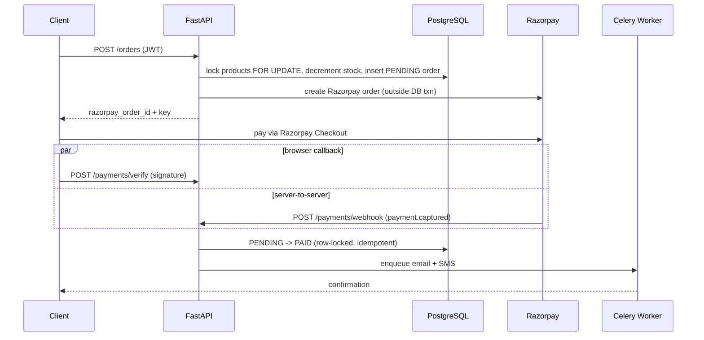

# E-Commerce Backend Platform

A production-style e-commerce backend built with **FastAPI**, **PostgreSQL**, **Redis**, **Celery** and **Razorpay**.
It focuses on the hard parts of commerce systems: payment reliability, inventory correctness under concurrency,
and keeping the API fast under load.

## Features

- **REST APIs** for auth, product catalog, order placement and checkout (FastAPI, JWT auth, Pydantic validation)
- **Razorpay payments**: server-side order creation, checkout signature verification, and **webhook handling**
  (HMAC-verified, idempotent) so payment status is confirmed even if the user closes the browser
- **Overselling prevention**: `SELECT … FOR UPDATE` row locks taken in sorted order (deadlock-free) plus a
  `CHECK (stock >= 0)` constraint; unpaid orders auto-expire and return stock
- **Background jobs** with Celery: SMS + email notifications with retries/exponential backoff, plus a beat job
  that releases stock held by unpaid orders
- **Performance & protection**: indexed PostgreSQL queries, Redis response caching with O(1) version-based
  invalidation, and Redis-backed rate limiting (fails open if Redis is down)

## Architecture



## Key design decisions

| Problem | Solution |
|---|---|
| Two buyers grab the last item | Row-level lock on product rows; stock check + decrement + order insert commit atomically |
| Deadlocks on multi-item orders | Locks always acquired in ascending `product_id` order |
| Duplicate / out-of-order payment events | `mark_order_paid` locks the order row and is idempotent; webhook events de-duplicated by event id |
| User pays but closes the tab | Webhook marks the order paid independently of `/verify` |
| Webhook forgery | HMAC-SHA256 over the **raw** body, constant-time compare |
| Abandoned checkouts hold stock forever | `expires_at` + Celery beat job restocks unpaid orders |
| Paid *after* expiry | Re-reserve stock; if unavailable, order becomes `REFUND_REQUIRED` |
| Holding DB locks during a network call | Razorpay call happens after the stock transaction commits |
| Slow SMS/email providers | Celery tasks with retries; API only enqueues |
| Hot read endpoints | Redis cache (TTL + version bump on writes), indexes on hot columns |
| Traffic bursts | Redis fixed-window rate limiter, stricter on `/orders` and `/auth` |

## Quick start (Docker)

```bash
cp .env.example .env        # add your Razorpay TEST keys
docker compose up --build
docker compose exec api python -m scripts.seed
```

API docs: http://localhost:8000/docs

### Without Docker

```bash
python -m venv .venv && source .venv/bin/activate
pip install -r requirements.txt
cp .env.example .env
uvicorn app.main:app --reload
celery -A app.tasks.celery_app.celery_app worker --loglevel=info      # terminal 2
celery -A app.tasks.celery_app.celery_app beat --loglevel=info        # terminal 3
```

### Razorpay webhook setup

1. Dashboard → Settings → Webhooks → add `https://<your-host>/payments/webhook`
2. Select events: `payment.captured`, `payment.failed`, `order.paid`
3. Set the secret and put it in `RAZORPAY_WEBHOOK_SECRET`
4. For local testing, expose your server with `ngrok http 8000`

## API overview

| Method | Path | Description |
|---|---|---|
| POST | `/auth/register`, `/auth/login` | Sign up / get JWT |
| GET | `/products?q=&skip=&limit=` | Cached catalog listing |
| GET | `/products/{id}` | Cached product detail |
| POST/PATCH | `/products`, `/products/{id}` | Admin only |
| POST | `/orders` | Reserve stock + create Razorpay order |
| GET | `/orders`, `/orders/{id}` | Your orders |
| POST | `/payments/verify` | Verify Razorpay checkout signature |
| POST | `/payments/webhook` | Razorpay webhook receiver |

## Tests

```bash
pytest -v
```
Includes signature-verification unit tests and a concurrency test (40 parallel buyers, stock of 5 →
exactly 5 succeed, stock never negative). The concurrency test needs Postgres and skips otherwise.

## Project layout

```
app/
  main.py            FastAPI app + error handling
  config.py          Pydantic settings (env-driven)
  models.py          SQLAlchemy models + indexes/constraints
  routers/           auth, products, orders, payments (+webhook)
  services/          inventory (locking), orders (state machine), payments (Razorpay), webhooks
  tasks/             Celery app, notifications, periodic stock release
  cache.py           Redis JSON cache with version-based invalidation
  rate_limit.py      Redis rate limiter dependency
tests/               unit + concurrency tests
```

## Possible improvements

Alembic migrations, refunds API, cart service, structured logging/Prometheus metrics, sliding-window or
token-bucket limiter, outbox pattern for notifications.
